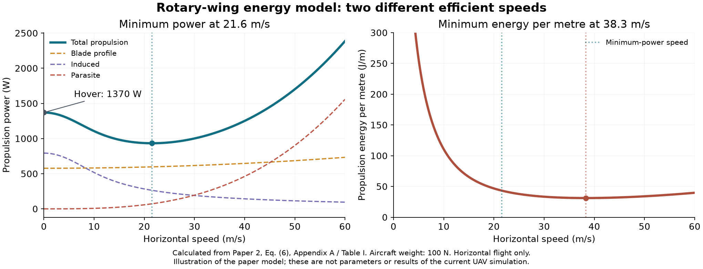

# Hướng dẫn đọc 5 bài báo cho mục tiêu EE của UAV

Ngày đọc và đối chiếu: 14/10/2026. Số trang bên dưới là trang PDF trong repo,
không phải số trang của tạp chí. Đây là ghi chú học và đề xuất mô hình;
không thay đổi evaluator, thuật toán hoặc thiết lập MATLAB.

## 1. Mục tiêu hiện tại và thứ tự học

Mục tiêu dài hạn: tối ưu tổng số bit phục vụ trên mỗi joule UAV tiêu thụ,
bao gồm năng lượng bay và truyền thông, trên nền UAV–SWIPT–NOMA của V8.
Bản `maincodeV9_EE.m` hiện là thử nghiệm EE RF: 20 slot, mỗi slot 1 s,
UL/DL mỗi pha 0.5 s, giả định dữ liệu UL đủ và chỉ tính RF downlink.
Tên V9_EE này không kế thừa các hướng V9/V10 lịch sử.

Loại UAV, EE theo tổng tải hay theo điện rút từ pin, mô hình bay thay đổi
độ cao, rate relay và mức QoS vẫn chưa được chốt.

Thứ tự đề xuất: **2 → 3 → 1 → 4 → 5**.

| Bài | Vai trò | Phần đọc trước | Mức ưu tiên hiện tại |
|---|---|---|---|
| 2 | Hiểu năng lượng bay, vận tốc và thời gian | II.B, trang 6–8; Fig. 1; IV.A, trang 16–18 | Rất cao |
| 3 | Xây dựng EE cho UAV relay NOMA, bottleneck và QoS | 4.1–4.2, trang 3–5; 5.2–5.3 | Rất cao |
| 1 | Đối chiếu cánh cố định, EE phân thức và NOMA | 2.3, trang 7–8; 4.2, trang 12–15 | Cao nếu chọn fixed-wing |
| 4 | Hiểu ghép nối EH–giải mã, phân biệt mục tiêu EE | II, trang 2–3; (9)–(12), (18) | Cao cho SWIPT |
| 5 | Hiểu EH phi tuyến và chi phí năng lượng nguồn BS | 2, trang 3; (11)–(13), trang 4 | Đọc sau khi khung EE rõ |

## 2. Bài 2: nguồn nền tảng về năng lượng bay

**Energy Minimization for Wireless Communication with Rotary-Wing UAV**
— Yong Zeng, Jie Xu, Rui Zhang.

File: [2_rotaryWing.pdf](2_rotaryWing.pdf). Bản trong repo là preprint
arXiv:1804.02238v1, năm 2018, 31 trang. Bản tạp chí: IEEE TWC 2019,
DOI [10.1109/TWC.2019.2902559](https://doi.org/10.1109/TWC.2019.2902559).

### 2.1. Bài giải quyết điều gì?

Một UAV cánh quay phục vụ nhiều ground node qua TDMA. Tác giả tối thiểu
tổng năng lượng UAV, đồng thời bảo đảm lượng dữ liệu yêu cầu của từng node.
Bài không có NOMA hay SWIPT. Giá trị chính cho dự án là mô hình propulsion
và cách gắn thời gian vào đường bay.

Min năng lượng chỉ tương đương max bit/J khi tử số được giữ cố định. Với
bài toán cho phép lượng bit thay đổi như thử nghiệm hiện tại, hai mục tiêu
có thể chọn hai nghiệm khác nhau.

### 2.2. Ba khoản năng lượng để UAV bay

Trang 6, công thức (6):

\[
P_{\mathrm{fly}}(v)=P_0\left(1+\frac{3v^2}{U_{\mathrm{tip}}^2}\right)
+P_i\left(\sqrt{1+\frac{v^4}{4v_0^4}}-\frac{v^2}{2v_0^2}\right)^{1/2}
+\frac12 d_0\rho sAv^3.
\]

- **Blade profile:** công suất thắng lực cản khí động của cánh rotor đang
  quay. Trong mô hình này, thành phần tăng theo bình phương tốc độ bay.
- **Induced:** công suất tạo dòng khí và lực nâng để giữ UAV trên không.
  Thành phần này giảm khi tốc độ bay ngang tăng trong mô hình đã xấp xỉ.
- **Parasite:** công suất thắng lực cản thân UAV, tăng theo lập phương tốc độ.

Tổng ba thành phần có thể giảm lúc đầu rồi tăng. Vì vậy, bay chậm hơn
không tự động tiết kiệm năng lượng hơn.

Ở v = 0: P_hover = P0 + Pi > 0. Bay treo vẫn tiêu thụ năng lượng, dù
quãng đường bằng 0. Tuy nhiên, tham số hóa hiện tại của dự án bắt y giảm
15 m mỗi slot; optimizer hiện không có lựa chọn bay treo.

### 2.3. Hai vận tốc tối ưu khác nhau

Trang 7–8, Fig. 1:

\[
v_{\mathrm{ME}}=\arg\min_{v\ge0}P_{\mathrm{fly}}(v),\qquad
v_{\mathrm{MR}}=\arg\min_{v>0}\frac{P_{\mathrm{fly}}(v)}v.
\]

ME tiết kiệm năng lượng cho một thời lượng bay cho trước; MR tiết kiệm
năng lượng để vượt một quãng đường cho trước. P(v) có đơn vị W = J/s,
còn P(v)/v có đơn vị J/m. Khi còn mục tiêu truyền dữ liệu, nghiệm EE phải
cân bằng cả chất lượng kênh, thời gian phục vụ và tải năng lượng.

Hình tính lại từ (6) và Table I / Appendix A:

Hình chỉ minh họa mô hình của bài 2, với trọng lượng 100 N (khoảng 10.2 kg),
R = 0.5 m, rho = 1.225 kg/m³ và các tham số của Table I. Diện tích đĩa rotor
tính bằng pi R² thay cho số làm tròn 0.79 m² trong bảng. Đây không phải
tham số phần cứng hoặc kết quả MATLAB của dự án.

### 2.4. Nối đường bay với joule

Trang 16–18, IV.A và (43), phân biệt path với trajectory: path chỉ cho
đường hình học; trajectory cần thêm thời gian đi trên đường đó.

Với đoạn bay ngang dài d_n và thời gian Delta_t_n:

\[
v_n=\frac{d_n}{\Delta t_n},\qquad
E_{\mathrm{fly},n}\approx P_{\mathrm{fly}}(v_n)\Delta t_n.
\]

Phép cộng tổng mét vừa thêm vào dự án là thông tin hữu ích, nhưng chưa
cho tổng joule. Công thức E = kL chỉ phù hợp khi đã có năng lượng mỗi mét
không đổi k theo giả định vận tốc và trạng thái bay xác định.

Giữ 1 s/slot không có nghĩa mọi đoạn có cùng tốc độ: dx và dz khác nhau
làm vận tốc khác nhau. Cần phân biệt d ngang và d 3D trước khi dùng công
thức bay ngang. Năng lượng bay phải được tính trong toàn slot, gồm cả UL
và DL, nếu UAV bay liên tục qua hai pha.

### 2.5. Giới hạn trước khi áp dụng

Công thức cơ bản giả định bay ngang ở độ cao cố định; bỏ qua năng lượng
bổ sung do gia tốc. Appendix A, trang 26–29, cho nguồn các tham số và phép
xấp xỉ lực nâng. Không thay v ngang bằng sqrt(vx²+vy²+vz²) rồi coi mô hình
đã mô tả đầy đủ lên/xuống và các chỗ đổi hướng.

Nếu chọn rotary-wing, có thể thử mô hình với độ cao cố định trước để cô
lập tác động propulsion. Nếu giữ tối ưu z, cần một mô hình bay đứng/3D có
nguồn phù hợp, hoặc mô tả rõ phép xấp xỉ và kiểm tra độ nhạy. Đây là đề
xuất để thảo luận, chưa phải lựa chọn đã được người dùng chấp thuận.

## 3. Bài 3: gần nhất với EE của UAV relay NOMA

**NOMA-based energy efficiency optimization for UAV-assisted relay
communication networks** — Min Li et al., Computer Networks 275 (2026),
111946. File: [3_relay_QoS.pdf](3_relay_QoS.pdf).
DOI [10.1016/j.comnet.2025.111946](https://doi.org/10.1016/j.comnet.2025.111946).

### 3.1. Học định nghĩa dữ liệu phục vụ qua relay

Một BS, một UAV relay decode-and-forward, nhiều user. BS→UAV dùng FDMA;
UAV→user dùng NOMA, mỗi slot chọn một user gần và một user xa. UAV bay
ở độ cao cố định. Không có EH trong bài này.

Trang 4, (9)–(10): rate đầu cuối bị giới hạn bởi chặng BS→UAV và chặng
UAV→user. Bài học là UAV không chuyển tiếp được lượng dữ liệu vượt lượng
nó nhận và giải mã thành công.

Khi chuyển ý tưởng đó sang mô hình UL/DL nối tiếp của dự án, phải so lượng
bit hai pha trên cùng slot. Nếu đã định nghĩa luồng BS→user, không có dữ
liệu tồn từ slot trước, công thức minh họa là:

\[
D_{n,u}=\min\{t_{\mathrm{UL},n}R_{\mathrm{UL},n,u},
                    t_{\mathrm{DL},n}R_{\mathrm{DL},n,u}\}.
\]

Ví dụ: UL cho một luồng 1 Mbit/s và DL 4 Mbit/s, mỗi pha 0.5 s. UL nhận
0.5 Mbit, DL có khả năng gửi 2 Mbit; lượng thực sự chuyển tiếp của luồng
trong slot chỉ tối đa 0.5 Mbit theo giả định trên.

Đây là cách diễn giải để thảo luận, không phải công thức chép nguyên xi
từ bài 3 hoặc đã triển khai. Dự án có 3 BS và 5 user: cần ánh xạ luồng và
phân chia năng lực UL trước khi dùng min từng user. Không gán toàn bộ rate
UL dùng chung cho từng user. Nếu có buffer, cần mô hình tồn dữ liệu và
nhân quả thay cho min từng slot; hiện chưa chọn mở rộng đó.

### 3.2. Học ranh giới EE và QoS

Trang 4, (16)–(20): EE là tỷ số tổng dữ liệu / tổng năng lượng UAV. Vì
slot có cùng thời lượng, hệ số thời gian chung triệt tiêu, để lại tỷ số
tổng rate / tổng công suất. Nếu các pha có thời lượng khác nhau, phải
giữ các trọng số thời gian tương ứng.

QoS trong (19) là yêu cầu tổng dịch vụ của từng user qua cả nhiệm vụ.
Nó không tương đương yêu cầu min-rate ở mọi slot. Học cách phân biệt:

- R[n,u] >= R_min,u: bảo đảm tốc độ trong từng slot được xét.
- sum_n D[n,u] >= D_min,u: bảo đảm tổng lượng dữ liệu cho cả chuyến.
- Jain hoặc một penalty fairness: đo/khuyến khích cân bằng, không tự bảo
  đảm một ngưỡng dịch vụ cụ thể.

QoS giúp giải thích đánh đổi: UAV phải phục vụ user xa tốt hơn có thể
phải đổi đường bay và tăng năng lượng. Không tự thêm scheduling hai
user/slot, quỹ đạo khép kín hoặc QoS của bài này vào dự án.

### 3.3. Đọc kỹ cách tác giả tính năng lượng

Trang 4 có propulsion và công suất truyền thông. Nhưng trang 5, mục 5.2,
nói rõ phần tiêu thụ do công suất RF phát không được tính vào mẫu số của
bước allocation; tác giả đặt tổng RF bằng Pmax. Vì vậy, tại quỹ đạo cố
định, bước đó trở thành max-rate. Không suy ra rằng max EE nói chung phải
phát công suất lớn nhất.

Đối với mục tiêu gồm truyền thông của dự án, phải tự định nghĩa PA losses,
mạch Rx/Tx và xử lý đã được gộp đến đâu.

### 3.4. Học thuật toán sau mô hình

Trang 5–7: BCD luân phiên scheduling, power, trajectory. SCA xây bài toán
xấp xỉ quanh nghiệm hiện tại; Dinkelbach xử lý mục tiêu phân thức; CVX
giải các bài toán con lồi. Đây là nguồn cho benchmark tương lai. Tên
“Global optimization algorithm” không tự chứng minh nghiệm tối ưu toàn
cục của bài toán không lồi; hội tụ giá trị mục tiêu cũng không đủ.

## 4. Bài 1: đối chiếu cánh cố định và cách tối ưu tỷ số

**Energy-efficient UAV communication: A NOMA scheme with resource
allocation and trajectory optimization** — Huilong Jin et al., PLOS ONE,
2024. File: [1_EE_fixedWing.pdf](1_EE_fixedWing.pdf).
DOI [10.1371/journal.pone.0301819](https://doi.org/10.1371/journal.pone.0301819).

Trang 7–8, (8)–(11): tử số là lượng bit tích phân theo thời gian; mẫu số
là propulsion của UAV cánh cố định bay ngang:

\[
P_{\mathrm{fly}}(v)=c_1v^3+\frac{c_2}{v},\qquad v>0.
\]

Vế c1 v³ tăng khi bay nhanh; c2/v tăng khi bay quá chậm. Mô hình không
mô tả hover, và chưa đủ để mô tả bay thay đổi độ cao/đổi hướng tùy ý.
Bài bỏ năng lượng truyền thông trong mẫu số với giả định propulsion lớn
hơn nhiều. Mục tiêu đã chọn của dự án gồm truyền thông, nên không kế
thừa việc bỏ thành phần đó mà chưa đánh giá.

Bài tối ưu clustering NOMA, power và trajectory. Greedy ghép kênh yếu
với mạnh; suboptimal cân bằng chênh kênh giữa các nhóm; hybrid kết hợp.
Các lựa chọn clustering khác ba optimizer Joint/Full PSO/Full IPSO.

Trang 12–15, học Dinkelbach qua ký hiệu thống nhất:

\[
\max_x D(x)/E(x)\quad\longrightarrow\quad
\max_x\{D(x)-\lambda E(x)\},\quad
\lambda_{k+1}=D(x_k)/E(x_k).
\]

Điều kiện E(x)>0 là cần thiết. Phép biến đổi phân thức không tự làm bài
toán con lồi. Bảo đảm lý thuyết phụ thuộc các giả định và cách giải bài
toán con; dùng PSO/SCA không tự cho tối ưu toàn cục.

PSO hiện có thể đánh giá trực tiếp D/E; chưa cần bọc Dinkelbach chỉ vì
các paper dùng nó. Ưu tiên chốt tử số, mẫu số và ràng buộc vật lý.

Các xu hướng số như EE theo độ cao và tỷ lệ cải thiện so với OMA chỉ là
kết quả scenario tác giả. Riêng giải thích độ cao ở trang 19 cần kiểm tra
lại với công thức và code trước khi dùng làm cơ sở vật lý.

## 5. Bài 4: coupling EH–ID và sự khác nhau giữa các mục tiêu EE

**Energy-Efficient THz NOMA for SWIPT-aided Miniature UAV Networks**
— Jalal Jalali et al. File: [4_decode_EEopt.pdf](4_decode_EEopt.pdf).
Đã xác minh: IEEE Communications Letters, 2024,
DOI [10.1109/LCOMM.2024.3372471](https://doi.org/10.1109/LCOMM.2024.3372471).
Nguồn metadata: [imec](https://imec-publications.be/entities/publication/27bdd17f-76f6-41d4-826a-522e2aaf87c8).

### 5.1. Power splitting tác động hai phía

Trang 2, (7)–(10): rho chia tín hiệu đầu vào cho EH và information
decoding. Khi rho tăng, phần dành cho EH tăng, nhưng phần tín hiệu cho
giải mã giảm. SINR phụ thuộc cả vị trí và loại noise trước/sau bộ chia.
Không giả định tăng rho luôn cải thiện EE đầu cuối.

Trong dự án hiện tại, phi được dùng cho EH/RF downlink; evaluator chưa
tính năng lực giải mã UL. Vì thế bài này giúp nhận ra một coupling cần
xét khi phát triển EE relay đầy đủ, không buộc tối ưu phi ngay.

### 5.2. Tổng tỷ số không phải tỷ số tổng

Trang 3, (18): bài tối ưu sum_n R_sum[n]/P_sum[n].
Mục tiêu hành trình đang dùng là sum_n D[n]/sum_n E[n].

Ví dụ minh họa, hai slot có số bit như nhau là 10 bit và dùng 1 J, 9 J:
EE hành trình = 20/10 = 2 bit/J; trung bình EE từng slot =
(10/1 + 10/9)/2 ≈ 5.56 bit/J. Hai tiêu chuẩn khác nhau.

Với E[n]>0, EE hành trình bằng trung bình EE từng slot với trọng số
E[n]/sum E[n]. Slot dùng nhiều năng lượng phải có trọng số lớn hơn.
Do đó không lấy trực tiếp thuật toán sum-of-ratios của bài 4 để giải
ratio-of-sums mà chưa điều chỉnh.

### 5.3. Các công thức cần kiểm tra trước khi dùng

Topology bài gồm source, miniature UAV relay, destination, direct link
và MRC; dùng THz, công suất bay hằng Pc. Nó khác BS–UAV–nhiều GU hiện tại.

Mẫu số alpha1+alpha2−Pt+Pc là cách hạch toán riêng của bài, không tự
đồng nghĩa tổng tải UAV hoặc điện rút từ pin. Công thức EH (11) không
thể hiện rõ nhân công suất nguồn alpha1+alpha2 mặc dù alpha là công suất
trong (5); cần xác minh normalization/đơn vị trước khi nhập vào code.
Phần (18a) xét EH tổng các slot cũng không tự bảo đảm năng lượng có sẵn
trước từng lần sử dụng nếu thiếu mô hình lưu trữ tương ứng.

## 6. Bài 5: EH phi tuyến và chi phí BS

**Energy efficiency maximization in UAV communication networks with
nonlinear energy harvesting** — Zhongyu Wang et al., Computer Networks
241 (2024), 110222. File: [5_BSEnergy.pdf](5_BSEnergy.pdf).
DOI [10.1016/j.comnet.2024.110222](https://doi.org/10.1016/j.comnet.2024.110222).

### 6.1. Học đặc tính mạch EH

Một BS nhiều anten cấp WPT cho nhiều UAV hover; các UAV gửi dữ liệu về
BS qua uplink NOMA. Không phải mô hình một UAV relay phục vụ nhiều GU.

Trang 3, (4)–(6), và Fig. 2: EH có đáp ứng logistic, hiệu suất biến đổi
theo RF input và công suất thu có bão hòa. Không có quy luật công suất
BS tăng bao nhiêu thì DC thu tăng tỷ lệ bấy nhiêu trong mọi miền hoạt động.
Tham số phải lấy từ mạch phù hợp, không chép bộ tham số của paper vào
scenario hiện tại. Bài này nói rõ không mô hình hóa chi tiết sensitivity.

Bản in (2) nhân thời gian nhưng gọi là received power, và (4)–(6) có ký
hiệu/hệ số cần đối chiếu nguồn logistic gốc trước khi triển khai. Quy trình
đúng về đơn vị là RF input [W] → DC output [W] → tích phân thời gian [J].
Chưa kết luận EH tuyến tính hiện tại sai trong miền đang chạy; trước tiên
cần biết RF input và đáp ứng mạch trong chính miền đó.

### 6.2. Học ranh giới năng lượng

Trang 4, (11): E_tot gồm mạch anten BS, tải UAV và năng lượng BS dùng
cho WPT. (12)–(13) thực tế dùng một tỷ số tổng throughput / tổng energy,
dù abstract có nói sum-of-ratios.

Nếu giữ EE riêng của UAV, không đưa toàn bộ chi phí BS vào mẫu số chỉ
vì bài 5 làm thế. Nếu báo thêm EE toàn mạng, phải xác định nguồn năng
lượng bên ngoài và tránh đếm RF chuyển BS→UAV thêm lần nữa như năng
lượng mới. Bài 5 là nguồn đối chiếu phạm vi và EH, chưa là evaluator
thay thế trực tiếp.

## 7. Tổng hợp thành khung nghiên cứu của dự án

### 7.1. Mẫu số cần học trước khi triển khai

Khung tổng tải, với các thành phần không trùng nhau:

\[
E_{\mathrm{load}}=\sum_n\left[
 P_{\mathrm{fly},n}\Delta t_n+
 \frac{P_{\mathrm{RF},n}}{\eta_{\mathrm{PA}}}t_{\mathrm{DL},n}+
 P_{\mathrm{c,Rx},n}t_{\mathrm{UL},n}+
 P_{\mathrm{c,Tx},n}t_{\mathrm{DL},n}+
 P_{\mathrm{aux},n}\Delta t_n\right].
\]

η_PA là hiệu suất khuếch đại, khác η_EH. P_RF/η_PA đã gồm RF output và
tổn hao PA; không cộng P_RF thêm một lần. P_c có thể gộp xử lý/giải mã,
nhưng cần nêu rõ phạm vi. SIC ở GU thuộc GU, không tự thuộc tải UAV.

Hiện code giả định E_H = P_RF t_DL. Nếu thêm η_PA<1 và mạch, EH hiện
được gán toàn bộ cho RF không tự cấp đủ điện cho các tải mới. Cần quyết
định phần cấp bằng EH, phần cấp bằng pin hoặc điều chỉnh công suất RF
khả thi; không chỉ thêm mẫu số và giữ diễn giải “EH cấp đủ mọi tải”.

Phân biệt hai chỉ số:

- EE_gross = D_served / E_load: hiệu quả trên toàn tải UAV.
- EE_battery = D_served / E_battery_draw: hiệu quả trên điện rút từ pin.

EH là nguồn cấp, không phải khoản tiêu thụ. Chỉ trừ phần EH thật sự dùng
được khi hạch toán pin, theo thời điểm sử dụng, tải được cấp và mức tích
trữ đầu/cuối. Người dùng chưa chọn một trong hai chỉ số trên.

### 7.2. Liên hệ kết quả đang quan sát

EE_RF rất lớn có thể phù hợp với mẫu số RF nhỏ mà code đang tính; không
chuyển số đó thành EE toàn UAV. Khi thêm propulsion/mạch, thứ hạng PSO và
IPSO có thể thay đổi, nhưng chưa có kết quả để nói luồng nào sẽ thắng.

Tổng quãng đường khác nhau không tự chứng minh tổng năng lượng khác
theo cùng thứ tự. Với thời lượng từng slot cố định và P(v) không tuyến
tính, cần tính từng đoạn. Đường gấp khúc cũng làm phép bỏ qua gia tốc
cần được xem xét; công thức chỉ theo tốc độ không trực tiếp tính năng
lượng do góc rẽ.

### 7.3. Lộ trình học đề xuất

1. Bài 2: hiểu ba thành phần propulsion, hover, ME/MR và P→E theo thời gian.
2. Bài 3: xác định bit được phục vụ qua hai chặng và ý nghĩa QoS.
3. Đối chiếu bài 1: hiểu vì sao fixed-wing dùng công thức khác; quyết định
   loại UAV sau khi hiểu giả định và nhu cầu chuyển động.
4. Bài 4: hiểu EH–ID, kiểu EE và ranh giới năng lượng trước khi dùng công thức.
5. Bài 5: kiểm tra EH phi tuyến/chi phí BS như phân tích mở rộng phù hợp.
6. Chốt một mô hình chung trước khi so sánh Joint PSO, Full PSO, Full IPSO.

Không cần đổi optimizer, thêm biến thời gian, scheduling, direct link,
THz hoặc EH phi tuyến chỉ để học các bài. Bước tiếp theo hợp lý là thống
nhất mô hình năng lượng, thời gian và dữ liệu; các công cụ tối ưu phục vụ
mô hình đó.
