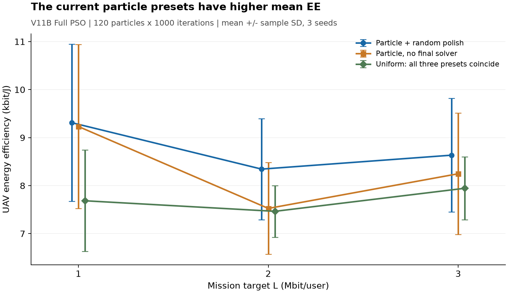

# Đối chiếu kết quả V11B với ý tưởng tách alpha vào solver bên trong fitness

Reference files read: exploration.md, grouping-and-aggregation.md, answering-data-questions.md, data-transformation.md (skill matlab-analyze-data).

**Kết luận:** trong các run hiện có, particle_noma_random có EE trung bình cao hơn cả ba preset uniform. Solver QoS cuối có C3 không thay đổi nghiệm nào của Full PSO: cả 9 case đều trả alpha đều ngay sau khi kiểm tra. Ý tưởng solver bên trong fitness chưa được triển khai/chạy, nên chưa có bằng chứng thực nghiệm rằng nó tốt hơn các kết quả này.

## Dữ liệu đã đọc và kiểm tra

Đã đọc CSV và MAT của ba thư mục thật:
- results/v11/alphaStudy/20261102_213033_522 — L=1 Mbit/user.
- results/v11/alphaStudy/20261102_220516_811 — L=2 Mbit/user.
- results/v11/alphaStudy/20261102_224049_740 — L=3 Mbit/user.

45 hàng = 5 preset × 3 mức L × 3 seed. Mỗi nhóm có n=3, seed 2026/608060/3486784401. Các hàng đều là **V11B / Full PSO, 120 particle × 1000 vòng**, không phải Full IPSO hay Joint. Cả 45/45 hàng đều feasible, missionQoS/userSlotQoS đều đạt. CSV/MAT khớp về EE và năng lượng; totalBits/totalEnergy tái dựng được eeUAV. Không dùng smoke 5×3 hay output tích hợp ngắn để tính các số này.

Tất cả alphaFinalizeJoint=0. Các run này không thử preset _fair và không cho kết luận về so sánh Joint–Full sau khi cân bằng finalization.

## 1. EE thật

Đơn vị bit/J, mean ± sample standard deviation; không phải confidence interval.

| L (Mbit/user) | particle_noma_random | particle_noma_none | Cả ba preset uniform | Gain trung bình random so với uniform |
|---|---:|---:|---:|---:|
| 1 | 9311,68 ± 1635,00 | 9232,16 ± 1706,17 | 7685,31 ± 1055,44 | +21,16% |
| 2 | 8344,68 ± 1052,31 | 7526,13 ± 955,38 | 7465,49 ± 537,73 | +11,78% |
| 3 | 8634,91 ± 1183,04 | 8247,98 ± 1266,15 | 7945,54 ± 656,39 | +8,68% |

Ba preset uniform là uniform_noma_none, uniform_noma_qos và uniform_noc3_qos. Với cùng L/seed, chúng giống **chính xác** về eeUAV, eeRF, totalBits, totalEnergy, các cờ khả thi, minDeliveredOverL và maxAlphaDeviationFromUniform. Cả 27 hàng uniform đều có maxAlphaDeviationFromUniform=0. Không chỉ mean±std tình cờ bằng nhau.

Chỉ 3 seed mỗi nhóm nên chưa có cơ sở tuyên bố ưu thế thống kê bền vững. Tại L=3 Mbit, particle_random chỉ cao hơn uniform ở seed 2026 (9806,45 so với 7677,07); hai seed còn lại uniform cao hơn nhẹ: 8693,61 so với 8657,57 và 7465,93 so với 7440,70. Không diễn giải gain trung bình 8,68% thành thắng mọi case.

Giữa mode particle và uniform, cùng scenario seed không đồng nghĩa cùng khởi tạo PSO: số chiều và lượng RNG tiêu thụ khác nhau. Các chênh lệch theo seed ở đây chỉ mô tả các nghiệm đã tìm được, không phải paired experiment cô lập riêng số chiều.

## 2. Solver QoS có C3 chưa tạo giá trị tăng thêm ở các nghiệm cuối

uniform_noma_qos có alphaRateEvals=20 ở cả 9 case, tương ứng 20 slot. Theo solveAlphaQoSV11, đó là đường trả sớm khi uniform đã đạt QoS và C3 bật. Solver không cần đi vào vòng tìm alpha ở các case này.

Đây là hành vi đúng với mô hình hiện tại: giữ nguyên quỹ đạo/BS, alpha đều vừa khả thi vừa tối đa tổng rate trong miền C3; mẫu số năng lượng không đổi theo alpha. Vì thế **đổi riêng solver cuối sang SCA cũng không thể tăng EE trên chính 9 hình học này dưới cùng C3**.

Phạm vi của lợi ích tiềm năng từ ý tưởng mới phải nằm ở việc PSO tìm hình học khác, gồm các hình học chỉ đạt QoS khi alpha được thích nghi. Bảng kết quả cuối không cho biết các hình học như vậy đã bị bỏ qua trong quá trình PSO bao nhiêu lần.

## 3. Vì sao particle vẫn tốt hơn dù nhiều alpha cuối cũng đều?

Ở L=1 Mbit, cả 3 particle_noma_random sau polish đều có max deviation=0, trong khi mean EE cao hơn uniform 21,16%. Hai nhánh kết thúc với alpha đều, nhưng tìm được các hình học khác nhau. Mean energy của particle_random là 6432,08 J so với 7206,29 J ở uniform; mean bits là 59,60 so với 55,61 Mbit.

Đây là bằng chứng trực tiếp rằng chỉ nhìn alpha cuối hoặc giảm 149→44 chiều không đủ để đánh giá chất lượng tìm kiếm. Các biến alpha trong quá trình joint search có thể tạo một đường tìm kiếm khác rồi mới được đưa về đều ở cuối; chênh lệch RNG cũng tham gia. Chưa thể tách riêng nguyên nhân nếu thiếu trajectory/history của từng run.

Polishing có đóng góp đo được: khi so trong cùng mode particle và cùng seed, totalEnergy khớp chính xác trước/sau ở cả 9 case. Mean EE tăng lần lượt 0,86%, 10,88%, 4,69% ở L=1/2/3. Đó là cải thiện phân bổ trên hình học đã giữ cố định. Chi phí Full fitness là 145121 so với 120120 lần, không phải bằng tổng ngân sách đánh giá.

6/9 particle_random cuối cũng đều; 3/9 còn lệch. Không kết luận các độ lệch đó bắt buộc bởi QoS chỉ từ bảng tổng hợp.

## 4. Nhánh bỏ C3 chưa kiểm chứng được lợi ích của bỏ C3

uniform_noc3_qos dùng 261708–278031 lần gọi rate/case, nhưng đầu ra vẫn uniform và các metric giống hệt hai nhánh uniform còn lại.

Do đó, không được kết luận “bỏ C3 không có tác dụng” hoặc “uniform là tối ưu khi bỏ C3”. Dữ liệu chỉ cho thấy solver hiện tại không trả được nghiệm tốt hơn uniform trong 9 case này. Khi bỏ C3, định lý tối ưu tại uniform của miền C3 không còn áp dụng.

Theo code, uniform khả thi được giữ làm ứng viên ban đầu có tổng shortfall=0. Ứng viên mới chỉ thay thế nó khi cũng có shortfall=0 và tổng bit cao hơn (đồng thời qua kiểm tra C5). Solver có thể thử rất nhiều nghiệm mà không tìm được một bước cải thiện vẫn khả thi. Chưa có trace để xác định chính xác cơ chế thất bại ở từng case.

Đó là điểm phù hợp để kiểm chứng hướng SCA có duy trì ràng buộc dữ liệu, thay vì suy luận solver hiện tại đã tìm tối ưu.

## 5. Thời gian và ngân sách

Mean wallClockSeconds qua 9 case:
- particle_noma_none: 139,35 s.
- particle_noma_random: 159,81 s.
- uniform_noma_none: 139,54 s.
- uniform_noma_qos: 138,83 s.
- uniform_noc3_qos: 138,13 s.

Cột thời gian đo **toàn runV11 gồm Joint, Full PSO, Full IPSO**, còn metric EE trong mỗi hàng chỉ của Full PSO. Không dùng thời gian này như latency riêng của Full PSO hoặc solver QoS. Chênh lệch vài giây giữa các nhánh uniform nằm trong biến thiên đo/scheduling; không suy ra bỏ C3 nhanh hơn từ nó.

Full swarm luôn 120120 fitness evaluations; random polish thêm 25001, QoS final thêm 1 lần mission evaluation và chi phí rate helper riêng. Dữ liệu hiện có không cho thấy giảm số chiều tự nó mang lại giảm đáng kể thời gian toàn run. Nếu đưa solver vài giây vào 120120 lần đánh giá mà không lọc/cải tiến, chi phí sẽ không thực tế.

## 6. Đối chiếu cụ thể với ý tưởng solver bên trong fitness

| Vấn đề | Điều kết quả cho thấy | Ý nghĩa với đề xuất |
|---|---|---|
| Alpha đều đã đủ ở nghiệm cuối | 9/9 uniform C3 đều khả thi | Solver cuối mới không có dư địa cải thiện trên các hình học này |
| Giảm outer dimension | 44 chiều có mean EE thấp hơn 149 chiều trong 3 nhóm | Không thể quảng bá giảm chiều thành lợi thế nghiệm hay tốc độ đã được chứng minh |
| Joint search giúp tìm hình học khác | L=1: particle sau polish và uniform đều alpha=0,2, EE vẫn chênh | Mục tiêu của nested solver phải là cải thiện cách chấm/tìm hình học |
| Solver noc3 không thay đầu ra | Nhiều rate evals nhưng vẫn uniform | Cần benchmark chất lượng solver alpha độc lập, nhất là duy trì QoS |
| Phương án mới chưa chạy | Không có score/runtime của PSO+SCA trong bảng | Chưa thể khẳng định nó thắng particle_noma_random |

Miền hình học khả thi với uniform là tập con của miền có tồn tại alpha thích nghi. Nếu giải inner alpha chính xác, phương án nested xét bài toán tổng quát hơn uniform-only. Nhưng nó vẫn là **cùng bài toán joint** với phương án particle-alpha khi cùng vật lý/ràng buộc; khác cách tổ chức tối ưu. SCA chỉ cho nghiệm cục bộ trong bài toán có C4 không lồi, và PSO có ngân sách hữu hạn, nên không có bảo đảm thực nghiệm thắng joint particle.

Mốc thực nghiệm cần vượt là **particle_noma_random**, không chỉ uniform_noma_qos. Trước một campaign mới, hợp lý nhất là giữ cố định một số hình học/kênh và so chất lượng alpha solver: uniform, QoS hiện tại, random polish, SCA; sau đó mới kiểm tra nested PSO trên cùng wall-time hoặc tổng chi phí thực tế. C3 bật và uniform khả thi phải được trả ngay; C3 tắt cần có ca cho phép vượt uniform để kiểm tra solver có tận dụng được hay không.

## Giới hạn dữ liệu và tái lập

Các table.mat thật chỉ chứa T và opts. opts ghi dryRun=false, variant B và mức L; không có cfg/sim đầy đủ, trajectory, BS cuối, h2UserTrace, pt theo slot, alphaTrace hoặc optimizer histories. Study chủ động tắt saveResults. Vì vậy chưa thể làm phép thay alpha phản thực hay chạy SCA trên đúng 45 hình học đã tìm được từ các file này. Không trộn results.mat của run tích hợp ngắn vào các case production.

Chưa lưu snapshot mã/config lúc chạy trong ba study; audit xác nhận các trường đã lưu, không chứng minh toàn bộ cấu hình radio/mission ngoài bảng chưa từng thay đổi. Chỉ phân tích lại dữ liệu đã có, không chạy optimizer, không sửa source V11/V10.

Bằng chứng kèm theo: all_45_runs.csv, grouped_summary.csv, audit.json, provenance.json, contrasts.json và MATLAB analysis log. Không suy diễn các lợi ích dự kiến của phương án mới thành số đo thực tế.
