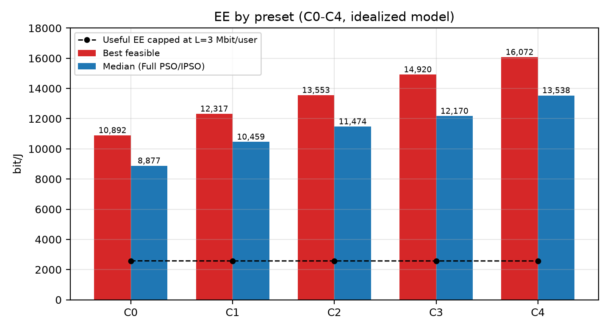
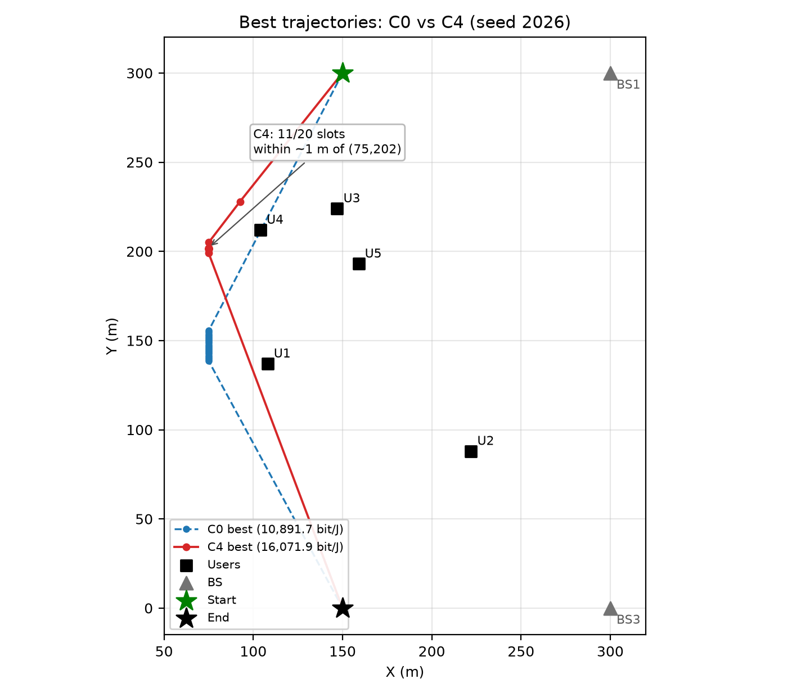
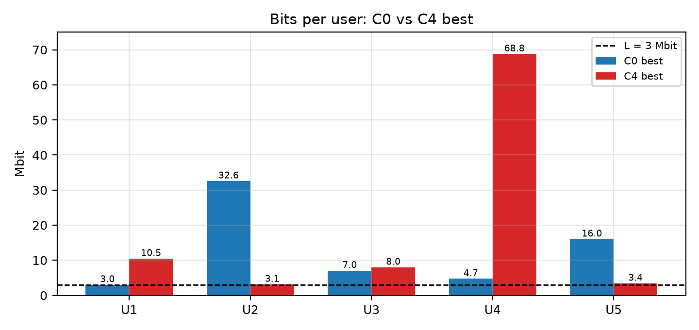

# V10C Campaign Report — 2026-11-03

## 1. Tóm tắt điều hành

Campaign đã chạy đủ **54 search**:

- 6 preset: C0–C5
- 3 seed: 2026, 608060, 3486784401
- 3 thuật toán: Joint PSO (BS cố định), Full PSO, Full IPSO
- 120 particle × 1000 vòng
- $L=3$ Mbit/user, $q=5$ kbit/user/slot, $E_{\max}=17\,000$ J

Thời gian chạy thực tế: **22:29:38–23:34:24**, khoảng **65 phút**.

Kết quả chính:

- EE tăng đơn điệu từ C0 đến C4.
- **C4 tốt nhất**: $16\,071.9$ bit/J (seed 2026, Full PSO).
- Median của Full PSO/IPSO: C0 $8\,876.9$ → C4 $13\,537.5$ bit/J.
- Tuy nhiên, **toàn bộ gain C0→C4 đến từ bit tăng, không phải năng lượng giảm**.
- Nếu chỉ tính bit hữu ích (cap tại $L=3$ Mbit/user), EE hữu ích gần như **không đổi** giữa C0 và C4: khoảng $2\,579$ và $2\,572$ bit/J.
- Quỹ đạo C1–C4 **co cụm về một pocket** quanh $(75,202)$; 11–15/20 slot nằm trong khoảng 1 m; nhiều bước di chuyển $<0.5$ m.
- C4 dồn **73.4% bit cho User 4**; Jain fairness giảm từ 0.574 (C0) xuống 0.357 (C4).
- C5 là mô hình thử nghiệm tăng/giảm tốc: chỉ **2/9 run feasible**, EE khoảng $2$–$3$k bit/J, không so trực tiếp với C4.

**Kết luận ngắn:** V10C tối ưu tốt mục tiêu EE *trong mô hình hiện tại*, nhưng nghiệm C4 là một **single-pocket dwell** (một điểm phục vụ với thời gian hover biến thiên), không phải quỹ đạo 20 điểm thực tế. Cần thêm $d_{\min}$/stop cost và ràng buộc fairness trước khi dùng làm kết quả nghiên cứu chính.



---

## 2. Thiết lập thí nghiệm

| Thành phần | Giá trị |
|---|---|
| Preset | C0–C5 |
| Seed | 2026, 608060, 3486784401 |
| Thuật toán | Joint PSO (fixed BS), Full PSO, Full IPSO |
| Particle × iteration | 120 × 1000 |
| Evaluation mỗi search | 120,120 |
| Tổng search | 54 |
| $L$ | 3 Mbit/user |
| $q$ | 5 kbit/user/slot |
| $E_{\max}$ | 17,000 J |
| Năng lượng tính | movement + hover + RF |
| Thời gian campaign | ~65 phút |

Ý nghĩa preset:

| Preset | Y | Hover | UL/DL split | Motion energy |
|---|---|---|---|---|
| C0 | Tiến ≥1 m/đoạn | Cố định 1 s | Cố định 50/50 | Zhang steady |
| C1 | Cho phép stay | Cố định 1 s | Cố định 50/50 | Zhang steady |
| C2 | Cho phép stay | Biến thiên | Cố định 50/50 | Zhang steady |
| C3 | Cho phép stay | Cố định 1 s | Biến thiên | Zhang steady |
| C4 | Cho phép stay | Biến thiên | Biến thiên | Zhang steady |
| C5 | Cho phép stay | Biến thiên | Biến thiên | Rest-to-rest thử nghiệm |

---

## 3. Feasibility

| Preset | Feasible | Best EE (bit/J) | Best run | Median EE (all feasible) | Median EE (Full PSO/IPSO) |
|---|---:|---:|---|---:|---:|
| C0 | 7/9 | 10,891.7 | 608060, Full PSO | 7,006.1 | 8,876.9 |
| C1 | 7/9 | 12,316.7 | 2026, Full IPSO | 10,041.0 | 10,458.8 |
| C2 | 7/9 | 13,553.0 | 2026, Full PSO | 11,207.8 | 11,474.0 |
| C3 | 7/9 | 14,919.7 | 2026, Full PSO | 11,277.4 | 12,170.4 |
| C4 | 7/9 | 16,071.9 | 2026, Full PSO | 13,494.3 | 13,537.5 |
| C5 | 2/9 | 2,963.4 | 3486784401, Full IPSO | 2,479.0 | 2,479.0 |

Nhận xét:

- C0–C4 đều **7/9 feasible**. Hai run không feasible luôn là **Joint PSO** (fixed BS), do thiếu $L$ hoặc $q$.
- Full PSO và Full IPSO **feasible 3/3** cho cả C0–C4.
- C0–C4 không bị ràng buộc năng lượng: best run chỉ khoảng **5.8 kJ**; toàn bộ run C0–C4 nằm dưới 17 kJ (cao nhất khoảng 9.7 kJ).
- C5 hầu hết không feasible vì **vượt năng lượng**; chỉ Full IPSO tìm được 2 nghiệm feasible.

---

## 4. EE và thành phần năng lượng

Bảng dưới là **run tốt nhất** của từng preset:

| Preset | Seed | Algorithm | EE (bit/J) | Bits (Mbit) | $E_{\rm move}$ (J) | $E_{\rm hover}$ (J) | $E_{\rm total}$ (J) | Distance (m) |
|---|---|---:|---:|---:|---:|---:|---:|---:|
| C0 | 608060 | Full PSO | 10,891.7 | 63.34 | 2,367.5 | 3,447.8 | 5,815.3 | 337.3 |
| C1 | 2026 | Full IPSO | 12,316.7 | 71.80 | 2,381.8 | 3,447.8 | 5,829.6 | 339.3 |
| C2 | 2026 | Full PSO | 13,553.0 | 78.99 | 2,380.3 | 3,447.8 | 5,828.0 | 339.1 |
| C3 | 2026 | Full PSO | 14,919.7 | 86.98 | 2,382.0 | 3,447.8 | 5,829.7 | 339.4 |
| C4 | 2026 | Full PSO | 16,071.9 | 93.74 | 2,384.6 | 3,447.8 | 5,832.3 | 339.7 |
| C5 | 3486784401 | Full IPSO | 2,963.4 | 30.51 | 6,853.2 | 3,443.7 | 10,296.9 | 351.2 |

Điểm quan trọng:

- Từ C0 đến C4, $E_{\rm total}$ gần như **không đổi** (5,815 → 5,832 J, +0.3%).
- Bit tăng từ **63.34 → 93.74 Mbit** (+48.0%).
- EE tăng từ **10,891.7 → 16,071.9 bit/J** (+47.6%).
- Vì vậy **gain EE là gain bit**, không phải tiết kiệm năng lượng.
- Hover chiếm khoảng **59%** năng lượng C4; movement khoảng **41%**; RF gần như bằng 0.

C5 thì ngược lại: movement tăng lên **6,853 J** (66.6% tổng năng lượng), do mô hình tăng/giảm tốc thử nghiệm. Đây là lý do EE C5 thấp hơn nhiều, nhưng **không nên so C5 với C4** vì khác backend năng lượng.

---

## 5. Gain đến từ đâu?

So với C0:

| Bước | Thay đổi | Bit gain | EE gain |
|---|---|---:|---:|
| C0 → C1 | Cho phép stay | +13.4% | +13.1% |
| C1 → C2 | Hover biến thiên | +10.0% | +10.0% |
| C2 → C3 | UL/DL split biến thiên | +10.1% | +10.1% |
| C3 → C4 | Cả hai | +7.8% | +7.7% |
| **C0 → C4** | | **+48.0%** | **+47.6%** |

C1 đã cho phép UAV đứng yên; C2 tối ưu thời gian hover; C3 tối ưu tỉ lệ UL/DL; C4 kết hợp cả hai. Cả ba đều làm tăng bit trên cùng một lượng năng lượng gần như cố định.

Tuy nhiên, “bit tăng” không có nghĩa là phục vụ tốt hơn cho tất cả user. Xem phần fairness bên dưới.

---

## 6. Quỹ đạo: một pocket, không phải 20 điểm

Đây là phát hiện quan trọng nhất.

Bảng thống kê quỹ đạo của run tốt nhất:

| Preset | Tổng $D$ (m) | Đoạn $<0.5$ m | Đoạn $\ge5$ m | Đoạn dài nhất (m) | Slot quanh pocket |
|---|---:|---:|---:|---:|---:|
| C0 | 337.3 | 0 | 2 | 162.7 | 1/20 (không có pocket) |
| C1 | 339.3 | 17 | 2 | 213.9 | 15/20 |
| C2 | 339.1 | 15 | 2 | 211.4 | 14/20 |
| C3 | 339.4 | 16 | 2 | 208.0 | 11/20 |
| C4 | 339.7 | 15 | 3 | 212.7 | 11/20 |
| C5 | 351.2 | 16 | 3 | 250.3 | 10/20 |

Với C4 tốt nhất:

- 15/20 đoạn ngắn hơn **0.5 m**.
- 11/20 slot nằm trong khoảng **1 m** quanh $(75,202)$; nhiều slot gần như trùng nhau đến **0.001–0.1 m**.
- Chỉ có **3 đoạn ≥5 m**: 92.1 m, 28.9 m và 212.7 m.
- UAV thực chất ở tại một pocket gần User 4, rồi phân bổ thời gian hover cho 20 slot.



Vì vậy:

- `serviceVisits = 20` trong CSV **không có nghĩa là 20 điểm phục vụ khác nhau**.
- Nếu đếm theo ngưỡng, C4 chỉ có khoảng **4–5 vị trí có ý nghĩa**.
- Đây là hệ quả của mô hình: bay 0.01 m gần như miễn phí, vì $E_{\rm move}=P_f(v)d/v$ và không có stop cost/$d_{\min}$.
- Cùng lý do, C0 bị ép 1 m/đoạn; C1–C4 được thả tự do nên “bò” quanh một điểm.

**Kết luận:** C4 không tối ưu một quỹ đạo 20 điểm; nó tối ưu **một điểm phục vụ + phân bổ thời gian**. Đây là artifact của mô hình, không phải quỹ đạo UAV thực tế.

---

## 7. Fairness: bit dồn cho User 4

Bit theo user của run tốt nhất (Mbit):

| Preset | U1 | U2 | U3 | U4 | U5 | Total | U4 share | Jain |
|---|---:|---:|---:|---:|---:|---:|---:|---:|
| C0 | 3.00 | 32.57 | 7.04 | 4.73 | 15.99 | 63.34 | 7.5% | 0.574 |
| C1 | 10.78 | 3.59 | 7.76 | 45.44 | 4.22 | 71.80 | 63.3% | 0.454 |
| C2 | 8.74 | 3.29 | 5.75 | 57.87 | 3.34 | 78.99 | 73.3% | 0.359 |
| C3 | 9.95 | 3.01 | 7.50 | 63.52 | 3.00 | 86.98 | 73.0% | 0.360 |
| C4 | 10.47 | 3.10 | 7.97 | 68.79 | 3.41 | 93.74 | 73.4% | 0.357 |
| C5 | 13.04 | 3.89 | 4.03 | 4.98 | 4.57 | 30.51 | 16.3% | 0.753 |



Nhận xét:

- Tất cả user đều đạt $L=3$ Mbit, nên nghiệm **hợp lệ QoS**.
- Nhưng C1–C4 dồn **63–73% bit cho User 4**. User 4 ở $(104,212)$, rất gần pocket $(75,202)$.
- Jain fairness giảm từ **0.574** (C0) xuống **0.357** (C4).
- Objective EE không có ràng buộc fairness; nó có lợi khi phục vụ thêm user có kênh tốt, dù user đó đã vượt xa $L$.

Nếu mục tiêu là **thu đủ dữ liệu cho mọi user**, con số EE 16k không phản ánh giá trị nhiệm vụ. EE hữu ích (cap tại $L$) của C0–C4 gần như bằng nhau:

| Preset | Bit hữu ích (Mbit) | $E$ (J) | EE hữu ích (bit/J) |
|---|---:|---:|---:|
| C0 | 15 | 5,815.3 | 2,579 |
| C1 | 15 | 5,829.6 | 2,573 |
| C2 | 15 | 5,828.0 | 2,574 |
| C3 | 15 | 5,829.7 | 2,573 |
| C4 | 15 | 5,832.3 | 2,572 |
| C5 | 15 | 10,296.9 | 1,457 |

Đây là lý do chính khiến “C4 tốt hơn C0 47.6%” không nên được diễn giải là “phục vụ hiệu quả hơn 47.6%” nếu ứng dụng chỉ cần đủ $L$.

---

## 8. So sánh thuật toán (C0–C4)

| Thuật toán | Feasible | Best EE | Median EE | IQR |
|---|---:|---:|---:|---:|
| Joint PSO (fixed BS) | 5/15 | 4,279.8 | 3,772.4 | 3,507–4,245 |
| Full PSO | 15/15 | 16,071.9 | 10,891.7 | 6,362–13,553 |
| Full IPSO | 15/15 | 15,574.1 | 10,876.7 | 8,160–12,317 |

Nhận xét:

- Joint PSO yếu hơn rõ rệt vì BS cố định; 2/3 seed không đạt $L$/$q$ ở mỗi preset.
- Full PSO và Full IPSO có median gần như bằng nhau.
- Full PSO có **đỉnh cao hơn** (16,072), Full IPSO có **phân bố hẹp hơn** (IQR 8.2k–12.3k so với 6.4k–13.6k).
- Không có bằng chứng IPSO vượt PSO một cách nhất quán. Kết quả phụ thuộc seed.

---

## 9. Độ nhạy seed

Tổng hợp theo seed (median C0–C4 chỉ tính Full PSO/IPSO, 10 run/seed):

| Seed | Feasible | Best EE | Best preset / algorithm | Median EE (C0–C4, Full) | Median bits | Median $E$ | Median $D$ |
|---|---:|---:|---|---:|---:|---:|---:|
| 2026 | 10/18 | 16,071.9 | C4, Full PSO | 12,690.0 | 74.0 Mbit | 5,831 J | 340 m |
| 608060 | 16/18 | 13,580.6 | C4, Full PSO | 11,508.8 | 66.8 Mbit | 5,804 J | 336 m |
| 3486784401 | 11/18 | 8,774.2 | C4, Full IPSO | 7,327.7 | 44.6 Mbit | 6,077 J | 375 m |

EE tốt nhất theo preset và seed:

| Preset | 2026 | 608060 | 3486784401 |
|---|---:|---:|---:|
| C0 | 10,784.6 | 10,891.7 | 7,006.1 |
| C1 | 12,316.7 | 11,104.7 | 8,304.0 |
| C2 | 13,553.0 | 12,135.7 | 7,855.0 |
| C3 | 14,919.7 | 13,438.0 | 6,773.3 |
| C4 | 16,071.9 | 13,580.6 | 8,774.2 |
| C5 | — | 1,995.0 | 2,963.4 |

- Seed 2026 cho kết quả tốt nhất; seed 3486784401 kém nhất.
- C4: 16,071.9 → 8,774.2 giữa seed tốt nhất và xấu nhất, **chênh 45.4%**.
- Vì vậy không nên báo cáo chỉ con số best 16,072; cần báo median/IQR và số seed.

---

## 10. C5 — mô hình thử nghiệm

| Chỉ số | Giá trị |
|---|---:|
| Feasible | 2/9 |
| Thuật toán feasible | chỉ Full IPSO (2/3 seed) |
| Best EE | 2,963.4 bit/J |
| Bits run tốt nhất | 30.51 Mbit |
| $E_{\rm total}$ run tốt nhất | 10,296.9 J |
| $E_{\rm move}$ | 6,853.2 J (66.6%) |
| $E_{\rm hover}$ | 3,443.7 J (33.4%) |
| Median $E$ toàn bộ C5 | 16,783 J |

C5 cho thấy nếu tính năng lượng tăng/giảm tốc rest-to-rest, movement energy có thể **gấp gần 3 lần** C4 và đẩy nhiều run vượt 17 kJ. EE giảm mạnh, nhưng đây là **mô hình khác**, chưa validate (không có jerk, attitude/yaw, gió, hiệu suất motor). Không dùng C5 để kết luận C4 kém hơn hay tốt hơn.

---

## 11. Hạn chế của kết quả

1. **Không có $d_{\min}$ hoặc stop cost**: bước 0.001–0.1 m gần như miễn phí; optimizer khai thác triệt để.
2. **Không có $D_{\max}$**: C0–C4 có thể chạy 328–887 m; best run khoảng 340 m, nhưng chưa kiểm tra ràng buộc tổng quãng.
3. **Y vẫn đơn điệu**: V10C chỉ cho stay, không cho Y quay lại; không phải free 2D như TSP của bài báo.
4. **Không tối ưu thứ tự waypoint**: thứ tự slot cố định; không có 2-opt/GA.
5. **Không có fairness**: EE dồn bit cho User 4; Jain giảm còn 0.357.
6. **Hover cap 20 s là binding**: C4 dùng đủ 20 s; chưa có sensitivity 10/20/30 s.
7. **RF gần như bằng 0**: EE chủ yếu là bài toán propulsion + hover, không phải RF.
8. **Không có PA/circuit energy**: phạm vi EE là movement + hover + RF.
9. **`serviceVisits` gây hiểu nhầm**: nên đếm vị trí theo ngưỡng (ví dụ >1 m hoặc >5 m).
10. **Chỉ 3 seed**: median/IQR còn yếu; chưa đủ để kết luận thống kê mạnh.
11. **PSO/IPSO là heuristic**: không bảo đảm global optimum.
12. **C5 chưa validate**: chỉ là thử nghiệm.

---

## 12. Khuyến nghị

Ưu tiên:

1. **Thêm $d_{\min}=10$ m hoặc stop cost** vào C4, rồi chạy lại. Nếu EE giảm mạnh, gain hiện tại là artifact của bước siêu nhỏ.
2. **Thêm ràng buộc fairness** hoặc cap bit/user; báo cáo EE hữu ích (cap tại $L$) bên cạnh EE tổng.
3. **Thêm $D_{\max}$** và kiểm tra các run 337–407 m.
4. **Tăng số seed** lên 5–10; báo median/IQR thay vì best.
5. **Sensitivity**: hover cap 10/20/30 s; $L=1/3/5$ Mbit; $q=0/5/10$ kbit; $E_{\max}$.
6. **Quyết định mô hình nhiệm vụ**: corridor sweep (Y đơn điệu) hay free 2D/TSP. Nếu free 2D, cần sửa repair và thêm 2-opt/GA.
7. **Validate C5** hoặc giữ ở mức exploratory, không dùng cho kết luận chính.
8. **Cập nhật guide** với kết quả thật và cảnh báo single-pocket artifact.

---

## 13. Nguồn dữ liệu

Campaign:

```text
results/v10c/comparisons/tp56c4ac89_c18b_4ba7_a165_f827ae426187/
├── comparison.csv
└── comparison.mat
```

- `comparison.csv`: 54 dòng, một dòng cho mỗi preset/seed/algorithm.
- `comparison.mat`: chứa `report.runs` (toàn bộ data từng run) và `report.summary`.
- Run gốc: `results/v10c/C0..C5/tp.../results.mat` và `summary.txt`.

Chạy lại:

```matlab
setup_project;
maincodeV10CCampaign;
```

Hình trong báo cáo:

- `figures/fig_ee.png`
- `figures/fig_trajectory.png`
- `figures/fig_bits_per_user.png`

---

## 14. Kết luận

1. **Trong mô hình hiện tại**, C4 là preset tốt nhất: EE best 16,071.9 bit/J, median Full PSO/IPSO 13,537.5 bit/J.
2. **Cơ chế gain** là tăng bit trên cùng năng lượng, chủ yếu bằng stay + hover time + UL/DL split, không phải giảm năng lượng bay.
3. **Nghiệm C4 co cụm** về một pocket; 11–15/20 slot gần như cùng một điểm, 15/20 đoạn <0.5 m. Đây là artifact của mô hình thiếu stop cost/$d_{\min}$.
4. **Fairness kém**: User 4 nhận 73.4% bit; EE hữu ích (cap tại $L$) gần như không đổi so với C0.
5. **C5** cho thấy năng lượng tăng/giảm tốc có thể làm EE giảm mạnh, nhưng mô hình chưa validate.
6. **Trước khi dùng kết quả cho bài báo**, cần thêm $d_{\min}$/stop cost, $D_{\max}$, fairness, nhiều seed hơn, và quyết định rõ corridor hay free 2D.
